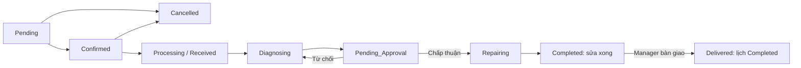

# Cơ sở dữ liệu Phong Vũ Help Center

[setup.sql](setup.sql) là **một script khởi tạo cho database Supabase mới**: tạo 10 bảng, ENUM, chỉ mục, ràng buộc, trigger Auth, RLS, RPC nghiệp vụ, bucket ảnh riêng tư và dữ liệu mẫu. Script chạy một lần trong một transaction, không chứa lệnh xóa bảng hay dữ liệu có sẵn. Chạy lại sẽ báo đối tượng đã tồn tại; hãy dùng migration riêng khi cần thay đổi sau này.

Thiết kế dựa trên SQL được cung cấp, phạm vi ở mục 1.4–1.5 trong Project Charter và giao diện hiện có. Đây là một cửa hàng, quản lý kiêm tiếp nhận. Không thêm thanh toán trực tuyến, tồn kho hay đa chi nhánh. Giá mẫu không phải giá niêm yết chính thức của Phong Vũ.

## Đánh giá thiết kế ban đầu

Các quan hệ chính đã đúng: hồ sơ gắn Supabase Auth; lịch hẹn nối tới phiếu sửa; chi tiết báo giá tham chiếu danh mục linh kiện. `item_name` và `price` ở dòng báo giá cần được giữ như dữ liệu chụp tại thời điểm lập giá, không lấy lại đơn giá hiện tại mỗi lần hiển thị.

Các phần đã bổ sung:

| Phần | Bổ sung và lý do |
| --- | --- |
| Lịch và phiếu | Mã `PV-…`, `SC-…` tự sinh; `updated_at`; một lịch chỉ có tối đa một phiếu; chỉ mục theo khách, KTV, ngày và trạng thái. |
| Trạng thái | Thêm `Processing` cho lịch đã nhận máy; `Completed` của phiếu là sửa xong, `Delivered` là đã bàn giao. Lịch chỉ hoàn tất khi bàn giao. |
| Báo giá | Số lượng dương, đơn giá không âm, `line_total` tự tính; tổng phiếu tính trong RPC lưu báo giá; giữ đơn giá và số tháng bảo hành tại thời điểm báo giá. |
| Quy trình | Khóa dòng khi ghi; kiểm tra chuyển trạng thái; kiểm tra người được phân công có role KTV; duyệt báo giá trước khi sửa. |
| Lịch sử | `service_events` ghi người thao tác, thời gian, trạng thái cũ/mới, ghi chú và phạm vi hiển thị. Client không được sửa hoặc xóa nhật ký. |
| Bảo mật | RLS theo tài khoản và công việc; giới hạn cột được sửa ở hồ sơ; không lấy role do người đăng ký tự gửi. |
| Danh mục | Thêm `services`; danh mục có `is_active` để ngừng sử dụng mà không xóa lịch sử. |
| Ảnh | Bucket riêng tư `service-images`; giới hạn 5 MiB, JPEG/PNG/WebP; lưu object path, tạo signed URL khi hiển thị. |

`technician_applications` và địa chỉ phục vụ tại nhà là phần hỗ trợ giao diện đã nhập, không phải yêu cầu bắt buộc của Charter. Nếu chỉ demo phạm vi đã chốt, dùng `service_location = 'store'` và cấp KTV qua SQL Editor. Không có luồng kho, hóa đơn hay thanh toán. Tổng giá trị phiếu đã bàn giao là giá trị dịch vụ minh họa, chưa phải doanh thu thanh toán.

## Chạy trên Supabase

1. Tạo project Supabase mới, mở **SQL Editor → New query**.
2. Dán toàn bộ [setup.sql](setup.sql), chạy bằng role `postgres` mặc định của SQL Editor.
3. Kết quả cuối file hiển thị số dòng: 4 dịch vụ, 7 dòng máy, 6 sự cố, 6 hạng mục giá, 6 lịch, 3 phiếu, 3 chi tiết báo giá và 9 sự kiện. Số người dùng tùy tài khoản Auth đã có.
4. Trong **Authentication → Users**, tạo tài khoản demo bằng email hoặc đăng ký qua Supabase Auth. Chọn mật khẩu riêng; script không tạo tài khoản/mật khẩu giả trong `auth.users`.
5. Cấp một tài khoản làm Manager và một tài khoản làm Technician bằng SQL dưới đây. Thay email bằng tài khoản vừa tạo; phần này chỉ chạy trong SQL Editor, không đưa vào trình duyệt.

```sql
-- Kiểm tra đúng tài khoản trước khi cấp quyền.
select id, full_name, email, role from public.users order by created_at;

update public.users set role = 'Manager'
where lower(email) = lower('EMAIL_QUAN_LY_CUA_BAN');

update public.users set role = 'Technician'
where lower(email) = lower('EMAIL_KY_THUAT_VIEN_CUA_BAN');

-- Các tài khoản còn lại mặc định là Customer.
```

Trigger tạo hồ sơ dùng email và tên; thay đổi email Auth cũng được đồng bộ. Thiết kế này dành cho đăng nhập bằng email; đăng nhập chỉ bằng số điện thoại chưa được hỗ trợ. Tạo tài khoản qua Dashboard/Auth API thay vì chèn trực tiếp vào các bảng Auth. Tham khảo [quản lý dữ liệu người dùng của Supabase](https://supabase.com/docs/guides/auth/managing-user-data).

### Liên kết dữ liệu mẫu với tài khoản

Sáu lịch mẫu ban đầu có `customer_id = NULL`, đại diện hồ sơ khách vãng lai/chưa liên kết. Chúng hiển thị cho Manager; Customer và KTV chưa được phân công không xem được. Đây là chủ ý để script chạy ngay khi chưa có tài khoản Auth, không bỏ qua khóa ngoại.

Để khách demo thấy dữ liệu và KTV có công việc, chạy phần sau trong SQL Editor sau khi thay email. Chỉ gán dữ liệu mang mã mẫu được liệt kê, không dùng truy vấn này cho dữ liệu thật.

```sql
begin;
do $$
declare customer uuid; technician uuid;
begin
  select id into customer from public.users
  where lower(email)=lower('EMAIL_KHACH_DEMO_CUA_BAN') and role='Customer' and is_active;
  select id into technician from public.users
  where lower(email)=lower('EMAIL_KY_THUAT_VIEN_CUA_BAN') and role='Technician' and is_active;
  if customer is null or technician is null then
    raise exception 'Cần thay đúng email tài khoản Customer và Technician đã tạo.';
  end if;

  update public.appointments set customer_id=customer
  where code in ('PV-10001','PV-10002','PV-10003','PV-10004','PV-10005');
  update public.repair_orders r set customer_id=a.customer_id, technician_id=technician
  from public.appointments a where r.appointment_id=a.id
    and a.code in ('PV-10002','PV-10004','PV-10005');
end;
$$;
commit;
```

Các phiếu mẫu đang tiếp nhận nằm ở `Received` để có thể demo chẩn đoán → sửa báo giá → gửi duyệt. Một phiếu ở `Delivered` minh họa lịch sử đã bàn giao. Để đo luồng thật, hãy tạo lịch mới qua RPC, không dùng mẫu đã bàn giao làm bằng chứng xử lý.

## Quyền truy cập

| Đối tượng | Đọc | Ghi |
| --- | --- | --- |
| Chưa đăng nhập | Danh mục đang hoạt động | Không có |
| Customer | Hồ sơ của mình; lịch, phiếu, báo giá, ảnh và nhật ký công khai thuộc mình | Sửa tên/điện thoại/địa chỉ; đặt hoặc hủy lịch; quyết định báo giá; gửi hồ sơ KTV |
| Technician | Hồ sơ của mình; lịch/phiếu/báo giá/ảnh/nhật ký của việc được giao | Cập nhật đúng việc, báo giá, ghi chú và ảnh; không bàn giao máy |
| Manager | Hồ sơ, lịch, phiếu, báo giá, nhật ký, hồ sơ ứng viên và ảnh | Danh mục; xác nhận, tiếp nhận, phân công, tiến độ, bàn giao và duyệt hồ sơ |

Các bảng nghiệp vụ chỉ cấp `SELECT` cho `authenticated`; ghi qua RPC có kiểm tra quyền và trạng thái. Riêng hồ sơ chỉ cấp `UPDATE` ba cột, nên khách không thể đổi `role`, `email` hay `is_active`. Tài khoản vô hiệu mất quyền dữ liệu nghiệp vụ. Danh mục công khai vẫn có thể đọc như khách chưa đăng nhập.

RLS kiểm tra role lưu trong bảng `users`, không dựa vào role gửi từ giao diện hoặc `user_metadata`. Các hàm `SECURITY DEFINER` đặt `search_path` rỗng, kiểm tra `auth.uid()` và được thu hồi quyền gọi mặc định; helper nội bộ nằm trong schema `private`. Tham khảo [RLS](https://supabase.com/docs/guides/database/postgres/row-level-security) và [bảo vệ database function](https://supabase.com/docs/guides/database/functions).

SQL Editor chạy với quyền cao và thường bỏ qua RLS. Việc thấy mọi dữ liệu ở SQL Editor không chứng minh quyền Customer/KTV đúng; cần kiểm tra bằng JWT đăng nhập thật khi tích hợp. Không đưa secret/service-role key vào mã phía trình duyệt.

## RPC và luồng nghiệp vụ

| RPC | Mục đích |
| --- | --- |
| `create_appointment` | Customer tạo lịch tương lai trong 90 ngày, giờ Việt Nam 08:00–19:30, bước 30 phút. |
| `change_appointment_status` | Manager xác nhận/hủy; Customer chỉ hủy lịch của mình trước tiếp nhận, phải ghi lý do. |
| `receive_device` | Manager nhận lịch đã xác nhận, tạo một phiếu và chuyển lịch sang `Processing`. |
| `assign_technician` | Manager phân công KTV đang hoạt động, trước khi phiếu hoàn tất. |
| `save_repair_quote` | Manager/KTV phụ trách thay toàn bộ báo giá trong transaction, chỉ khi `Diagnosing`. |
| `change_repair_status` | Chuyển `Received → Diagnosing → Pending_Approval`; `Repairing → Completed → Delivered`. |
| `decide_repair_quote` | Customer sở hữu phiếu duyệt/từ chối; Manager xác nhận thay phải ghi căn cứ. Duyệt chuyển `Repairing`, từ chối về `Diagnosing`. |
| `add_repair_note` | Ghi nhật ký công khai hoặc nội bộ trước khi bàn giao. |
| `add_repair_image` | Gắn object đã upload vào phiếu đúng quyền, tối đa 10 ảnh. |
| `submit_technician_application` | Customer gửi hồ sơ hoặc gửi lại hồ sơ bị từ chối. |
| `review_technician_application` | Manager duyệt/từ chối; chỉ khi duyệt mới đổi role thành Technician. |



Ví dụ phía client sau khi người dùng đăng nhập thật:

```ts
const { data, error } = await supabase.rpc("create_appointment", {
  p_customer_name: "Nguyễn Minh Anh",
  p_phone_number: "0901234567",
  p_laptop_model: "Dell Inspiron 14",
  p_scheduled_time: selectedDateTime, // ISO 8601 có offset, ví dụ ...T09:00:00+07:00
  p_service_code: "upgrade",
  p_issue_description: "Cần kiểm tra khả năng nâng cấp SSD",
});

const quoteItems = [
  { component_id: componentId, item_name: "SSD NVMe 512GB", quantity: 1, price: 890000 },
  { component_id: null, item_name: "Công lắp đặt", quantity: 1, price: 200000 },
];
await supabase.rpc("save_repair_quote", {
  p_repair_order_id: repairOrderId,
  p_items: quoteItems,
});
```

`save_repair_quote` khóa phiếu trước khi thay dòng và cập nhật tổng; lỗi bất kỳ sẽ rollback cả báo giá. Không sửa dòng báo giá trực tiếp bằng SQL Editor trong luồng vận hành, vì tổng được quản lý qua RPC này. Giá cho phép nhập theo báo giá thực tế; không bắt buộc trùng giá danh mục.

Chỉ mục chống trùng lịch áp dụng **cùng một khách và cùng thời điểm**, không giới hạn số khách của cả cửa hàng ở một khung giờ. Quản lý công suất hoặc lịch làm việc KTV là phần phát triển tiếp, chưa có trong script. Không có cập nhật Realtime tự động; frontend có thể tải lại sau thao tác hoặc polling.

## Lưu và đọc ảnh

- Ảnh sự cố: upload trước vào `service-images/users/<auth.uid()>/<uuid>.jpg`, truyền object path vào `p_image_urls` khi tạo lịch.
- Ảnh tiếp nhận/sửa chữa: KTV đúng việc hoặc Manager upload vào `service-images/repairs/<repair_order_id>/<uuid>.jpg`, rồi gọi `add_repair_image`.
- Các cột `image_urls`/`device_images` chứa path **không có tên bucket**, không chứa URL công khai/signed URL. Lấy signed URL ngắn hạn qua Storage SDK khi hiển thị.
- Dùng tên file mới, `upsert: false`. Không cấp quyền cập nhật/xóa object để giữ ảnh đã gắn với lịch sử. Chưa có tác vụ dọn ảnh upload nhưng chưa gắn lịch.
- MIME và kích thước được Storage API kiểm tra theo bucket. Script không upload file ảnh thật.

Bucket riêng tư cần RLS khi đọc/upload; xem [Storage access control](https://supabase.com/docs/guides/storage/security/access-control).

## Ánh xạ sang giao diện hiện tại

Ứng dụng đã kết nối Supabase Auth và đọc dữ liệu qua `views/api/supabase-snapshot.ts` khi có cấu hình `.env.local`. Luồng đăng ký/đăng nhập và hồ sơ nằm trong `views/api/auth-actions.ts`. Các thao tác ghi nghiệp vụ ngoài tài khoản vẫn cần nối tới RPC bên trên; hiện chúng trả lỗi rõ ràng thay vì giả lập lưu thành công.

| Database | Frontend hiện tại |
| --- | --- |
| `users` | `profiles`; `phone_number → phone`; role chuyển sang chữ thường |
| `appointments.phone_number` | `customer_phone` |
| `appointments.laptop_model` | `device_info` |
| `appointments.scheduled_time` | `appointment_date` |
| `appointments.service_id` | Join `services.code → service` |
| `repair_orders` | `tickets`; `serial_number`; `initial_condition → intake_notes` |
| `repair_orders.received_by` | `manager_id` |
| `repair_orders.total_amount` | `total_price` |
| `repair_order_details` | `quote_items`; `component_id → part_id`; `price → unit_price` |
| `components` | `parts`; `unit_price → price`; `is_active → is_available`; định dạng `warranty_months` |
| `service_events` | `events`; `repair_order_id → ticket_id`; `new_status → status` |
| `technician_applications` | Trạng thái chuyển sang chữ thường; join `users` để lấy thông tin liên hệ |

`Processing → processing`, `Pending_Approval → pending_approval`. Adapter đã đổi trạng thái sang chữ thường và ID danh mục sang string. Giao diện có nhãn chờ duyệt báo giá; vẫn cần thêm bước/nút duyệt khi nối các thao tác ghi, không được bỏ qua quy tắc tại DB để khớp giao diện cũ.

## Kiểm tra đã thực hiện

```sh
npm ci --prefix supabase/tests
npm test --prefix supabase/tests
```

Kiểm tra chạy bằng PostgreSQL nhúng PGlite trong bộ phụ thuộc riêng, không đổi dependencies của ứng dụng. Bộ kiểm tra dựng Auth/Storage giả tối thiểu rồi chạy chính `setup.sql`: kiểm tra schema/seed, trigger, RLS giữa nhiều tài khoản, cấm nâng role, quy trình đầu cuối, báo giá và rollback, nhật ký nội bộ, quyền ảnh, duyệt KTV và vô hiệu tài khoản.

Đây là kiểm tra ở mức PostgreSQL, **chưa chạy trên project Supabase thật**. Auth email/password, cấu hình Data API, upload MIME/dung lượng, signed URL và JWT cần kiểm tra thêm trên project sau khi khởi tạo. Không cần chia sẻ khóa bí mật để đọc hoặc chạy file SQL trong Dashboard của bạn.
